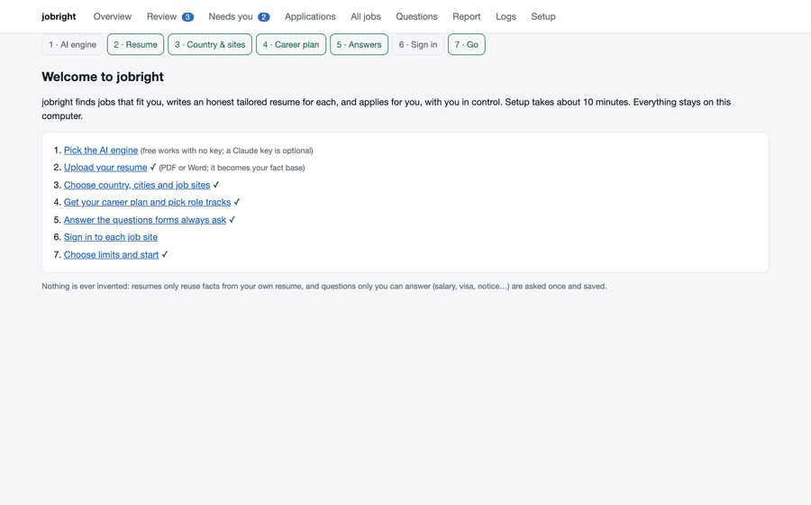
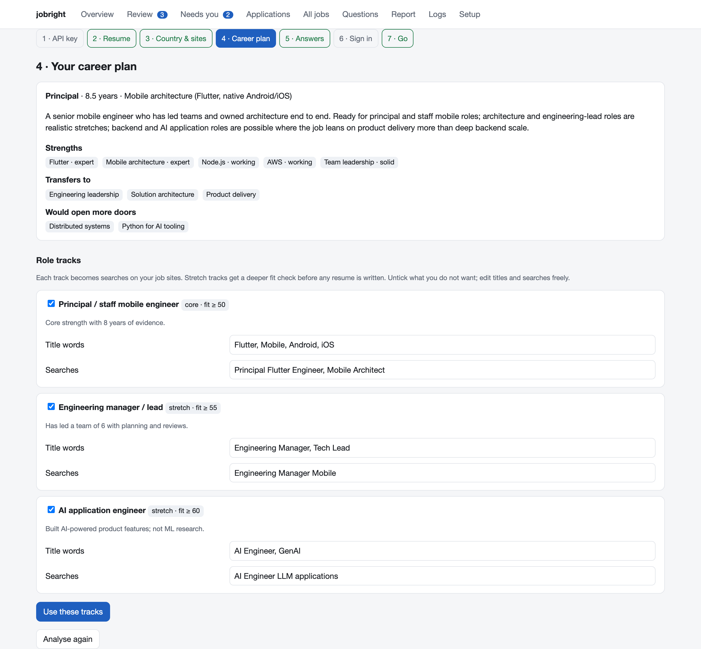
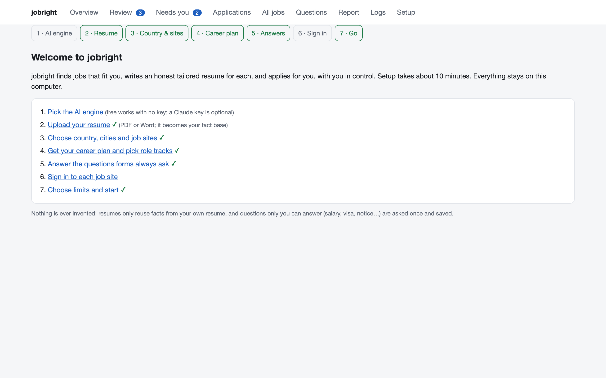
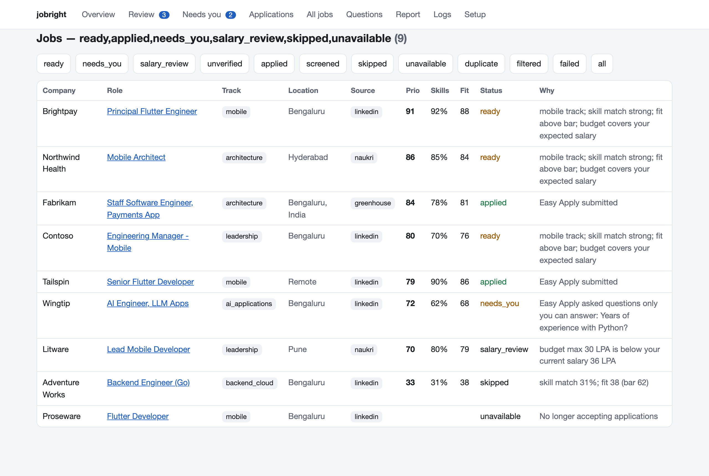
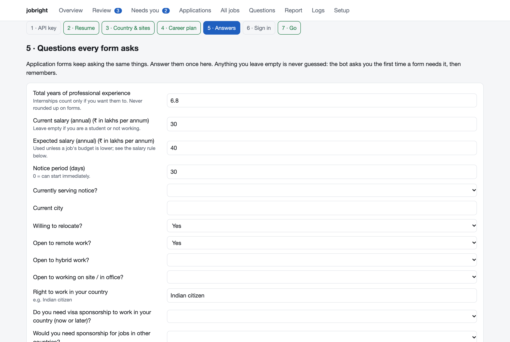
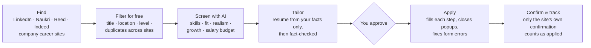

<div align="center">

# jobright

**An honest AI job-search agent that runs on your own computer. Free, and no API key needed.**
It finds jobs that fit you, builds a tailored resume for each one from your real experience, fills in the application, and only applies when you say so.

[](https://github.com/ChandraChaan/jobright/actions/workflows/ci.yml)


[](https://github.com/ChandraChaan/jobright/stargazers)

[Install](#install-in-one-line) · [Free, local or Claude](#pick-your-engine-free-local-or-claude) · [How it works](#how-it-works) · [Sites & countries](#sites-and-countries) · [Honesty rules](#the-honesty-rules) · [FAQ](#faq)



</div>

---

Most "auto-apply" bots spray the same resume at hundreds of jobs and make things up on forms. jobright works the other way round:

- **It applies to fewer, better jobs.** Every job description is scored against your real experience, and you choose the skill-match and fit bar. Jobs are ranked by fit, growth potential and the job's own salary budget.
- **Every resume is tailored and fact-checked.** Each resume is rewritten for one job from *your* facts only. A second AI pass checks every line against your profile, and anything it can't back up is replaced with your original wording.
- **It never guesses about you.** Salary, notice period, visa status, passport, years with a skill: it answers only from what you've told it. A new question comes to you once and is remembered.
- **You stay in control.** Review mode is on by default: nothing is submitted until you press **Approve**. Applications count as done only when the job site confirms them.
- **It's free and private.** It runs on your machine. Out of the box it needs no API key and costs nothing. Add a free local model or your own Claude key if you want more. Your resume, answers and logins never touch our servers, because there aren't any.
- **It learns what works.** Mark interviews and rejections, and the role tracks that get replies rank higher next time. It also won't re-apply to a company that just turned you down.

## Install in one line

**macOS / Linux**
```bash
curl -fsSL https://raw.githubusercontent.com/ChandraChaan/jobright/main/install.sh | bash
```

**Windows (PowerShell)**
```powershell
irm https://raw.githubusercontent.com/ChandraChaan/jobright/main/install.ps1 | iex
```

The installer sets up its own Python environment, installs the browser engine, adds a `jobright` command and opens the **setup wizard** in your browser. All you need is Python 3.11+ ([download](https://www.python.org/downloads/)). No account and no API key are required.

Then, any time:
```bash
jobright start     # open the app
jobright doctor    # check the install
```

## Pick your engine: free, local or Claude

Every engine follows the same honesty rules. They differ in how much they understand.

| | **Free** (default) | **Local AI** | **Claude** |
|---|---|---|---|
| Cost | $0 | $0 | about $20–60 a busy month, on your own key |
| Needs | nothing | [Ollama](https://ollama.com) and `ollama pull qwen2.5:7b` (8 GB+ RAM) | an [Anthropic API key](https://console.anthropic.com/settings/keys) |
| Reads job descriptions | rules: skills, years, level, salary budget | a model on your computer | Claude, with a second deeper check for stretch roles |
| Your resume per job | your own lines, picked and ordered for the job | same as Free | rewritten for the job, then fact-checked line by line |
| Unusual form questions | asks you once | understood locally | understood by Claude |
| Privacy | nothing leaves your computer | nothing leaves your computer | job text and your facts go to Anthropic under your key |

`auto` (the default) uses Claude if a key is saved, else Local AI if Ollama is running, else Free. Switch any time in **Setup → AI engine**.

## How it compares

| | jobright | Typical auto-apply bots | Paid AI apply services |
|---|:-:|:-:|:-:|
| Runs on your own computer | ✅ | some | ❌ |
| Free to run | ✅ | some | ❌ (monthly fee) |
| Tailored resume for every job | ✅ | ❌ | ✅ |
| Never invents experience (checked in code) | ✅ | ❌ | ? |
| Never guesses salary, visa or notice answers | ✅ | ❌ | ? |
| Review before anything is sent | ✅ default | rarely | some |
| Counts only confirmed applications | ✅ | ❌ | ? |
| Open source | ✅ MIT | some | ❌ |

## The 10-minute setup

| Step | What happens |
|---|---|
| 1. **AI engine** | Free, Local AI or Claude. Free needs nothing, and you can change it later. |
| 2. **Resume** | Upload a PDF or Word file. It becomes your *master profile*: every fact with an id. Lines that can't be traced back to the file are flagged for you to check. |
| 3. **Country & sites** | Pick your country, cities and job sites. Add companies to avoid, such as your current employer. |
| 4. **Career plan** | jobright reads your profile like a candid career advisor: your level, how deep each strength really goes, and what transfers. It proposes **role tracks**, from your core roles to realistic stretch roles, each with its own searches. Untick anything you don't want. |
| 5. **Answers** | The questions every form asks, with fields that fit your country (salary in £/₹/$, right to work, sponsorship, notice period…). Leave anything blank and it will ask when needed. |
| 6. **Sign in** | Log in to each site in the bot's own browser window. jobright never sees your passwords. |
| 7. **Go** | Choose how often it searches and your budget, and it starts. |

<table>
<tr>
<td width="50%"><br><sub><b>Career plan:</b> an honest read of your level and strengths, with role tracks from core to stretch</sub></td>
<td width="50%"><br><sub><b>Setup wizard:</b> from install to running in about 10 minutes</sub></td>
</tr>
<tr>
<td width="50%"><br><sub><b>Every job</b> with its track, priority, skill match, fit, and why it was picked or skipped</sub></td>
<td width="50%"><br><sub><b>Answers once:</b> fields that fit your country, never guessed</sub></td>
</tr>
</table>

*Screenshots use a fictional person and made-up companies.*

## How it works



- **Matching.** Skill match is counted in code (must-have skills weigh double), so it's predictable. Fit and realism come from the engine you picked. Stretch roles get a second, deeper check before any money is spent on a resume. Jobs asking for clearly more experience than you have are skipped.
- **Forms.** Each field is understood by what it asks (years with Kotlin? expected salary in LPA? a phone number?) and by the type and unit it expects. Values are validated before they're typed. If a site rejects a value, jobright reads the error ("enter a whole number") and fixes the format. Wrong answers the site pre-filled from older applications are corrected.
- **Salary.** When a job states a budget, jobright asks for `min(your expected, the job's max)`. If the budget is below your current salary, the job comes to you instead.
- **Interruptions.** Cookie banners get "Reject all". Popups get "Not now" or "Close", never "Accept" or "Upgrade". If a popup closes the application, jobright reopens the saved draft. Removed postings are marked unavailable, and security checks pause that site for the run.
- **Learning.** After 15 applications, role tracks with more interviews rank higher and those with none rank lower, by at most 15%, so one bad week can't reshape your search. Companies that rejected you are skipped for 90 days.
- **Tracking.** The dashboard shows every job, why it was picked or skipped, the resume used, every answer given with its source, and the confirmation the site showed.

## Sites and countries

| | India | United Kingdom | United States | Elsewhere |
|---|:-:|:-:|:-:|:-:|
| LinkedIn (search + Easy Apply) | ✅ | ✅ | ✅ | ✅ |
| Company career sites (Greenhouse, Lever, Ashby) | ✅ | ✅ | ✅ | ✅ |
| Naukri | ✅ | | | |
| Reed (official API) | | ✅ | | |
| Indeed | | 🧪 beta | 🧪 beta | |

Add a country by copying a block in [`jobright/defaults/countries.yaml`](jobright/defaults/countries.yaml). Add a site by following [`docs/adding-a-site.md`](docs/adding-a-site.md).

## The honesty rules

These are enforced in code, not just in prompts:

1. A tailored resume may only reorder and reword facts from your master profile. Every line cites the facts it comes from. Numbers must appear in those facts, skills must be in your profile, and a bullet under an employer may only use that employer's facts.
2. A second model checks every line against its cited facts. Lines that fail are rewritten, and if they fail again they're replaced with your own wording.
3. Personal answers (salary, notice, visa, passport, years with a skill) come only from your answers. The AI may say what a question *means*; it never supplies the answer.
4. Nothing is submitted in review mode until you approve it, and nothing counts as applied without the site's own confirmation.

## What it costs

**Nothing.** jobright is free and open source, and the Free and Local AI engines cost $0 to run.

With the optional Claude engine you pay Anthropic directly: reading a job costs about $0.002, and a rewritten, fact-checked resume about $0.25. A busy month is roughly **$20–60**. Set a monthly budget in the app and a hard cap in the Anthropic console.

## Use it responsibly

Automating job sites can break their terms of service, and you're responsible for how you use jobright on your accounts. It's built to behave like a careful person: low daily limits, pauses between pages, review mode by default, and it stops at CAPTCHAs and security checks instead of trying to get past them. Please keep it that way.

## FAQ

<details><summary><b>Does it work for graduates and career changers?</b></summary>
Yes. The career plan reads your level from your dated experience. Graduates get graduate-scheme, junior and associate tracks, and their resumes lead with education and projects. Career changers get adjacent tracks backed by the evidence that transfers, with a stricter fit bar.
</details>

<details><summary><b>Will it apply to hundreds of jobs a day?</b></summary>
No, by design. Defaults are 25 a day on LinkedIn, at most 3 applications to one company in 30 days, and only jobs above your fit bar. You can change the limits, but fewer, better applications get more interviews.
</details>

<details><summary><b>Where is my data?</b></summary>
In <code>~/.jobright</code> (Windows: <code>%USERPROFILE%\.jobright</code>): your profile, answers, database, resumes and the bot's browser profile. With Free or Local AI, nothing leaves your computer except the applications themselves. With Claude, job descriptions, your profile facts and form questions go to Anthropic's API under your own key.
</details>

<details><summary><b>Can I use it without an API key?</b></summary>
Yes, and that's the default. The Free engine handles screening, resumes, resume import and the career plan with rules and your own words. For smarter reading at no cost, install <a href="https://ollama.com">Ollama</a> and jobright uses it automatically.
</details>

<details><summary><b>Mac asleep?</b></summary>
Scheduled runs happen while you're logged in and the computer is awake. A missed run happens when it wakes. On macOS, <code>sudo pmset repeat wake MTWRFSU 08:00:00</code> wakes it daily.
</details>

## Commands

```bash
jobright start                 # open the app (setup wizard on first run)
jobright run                   # one full cycle now
jobright import resume.pdf     # rebuild your profile from a resume
jobright plan                  # re-run the career analysis
jobright login linkedin        # sign in to a site in the bot's browser
jobright apply --dry-run       # fill approved applications, stop before submit
jobright schedule install      # run every few hours (launchd / Task Scheduler / systemd)
jobright doctor                # check everything
```

## Project layout

```
jobright/
  engine.py         free / local (Ollama) / Claude, picked automatically
  heuristics.py     the free engine: rule-based screening, resumes, import, plan
  learn.py          learning from your interviews and rejections
  onboard.py        resume → master profile → career plan
  sources/          LinkedIn, Naukri, Reed, Indeed, Greenhouse/Lever/Ashby
  jd.py runner.py   screening, tracks, priority, the run loop
  tailor.py verify.py pipeline.py render.py   resume writing and fact checking
  apply/            fields → values → forms, popup guard, site engines
  dashboard.py setup_ui.py templates/         the local web app
  defaults/         settings and per-country data
tests/              runs on a fictional person, including a mock Easy Apply
```

## Contributing

Issues and pull requests are welcome, especially for **new countries and job sites**, for form patterns the agent doesn't understand yet, and for translations. See [CONTRIBUTING.md](CONTRIBUTING.md). Run the tests with `pip install -e ".[dev]" && python -m playwright install chromium && pytest`.

If jobright helps you land something, a ⭐ helps others find it. Questions and ideas are welcome in [Discussions](https://github.com/ChandraChaan/jobright/discussions).

## License

[MIT](LICENSE) © [ChandraChaan](https://github.com/ChandraChaan). Not affiliated with LinkedIn, Naukri, Reed, Indeed or Anthropic.

<div align="center"><sub>Built by <a href="https://github.com/ChandraChaan">ChandraChaan</a> · <a href="https://github.com/ChandraChaan/jobright/stargazers">⭐ Star it</a> · <a href="https://github.com/ChandraChaan/jobright/issues/new/choose">Report a bug</a></sub></div>
